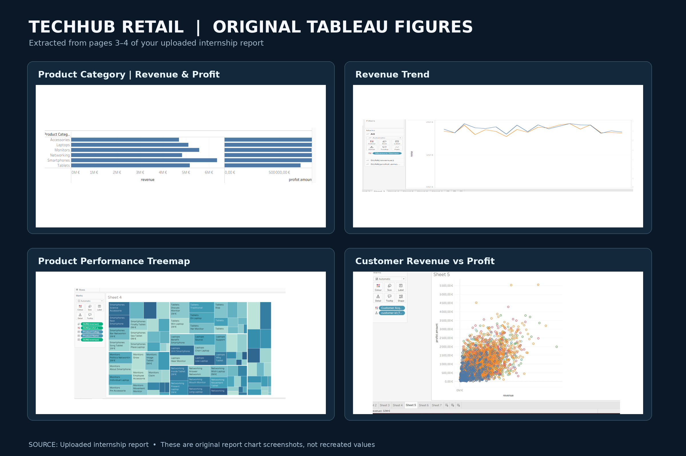
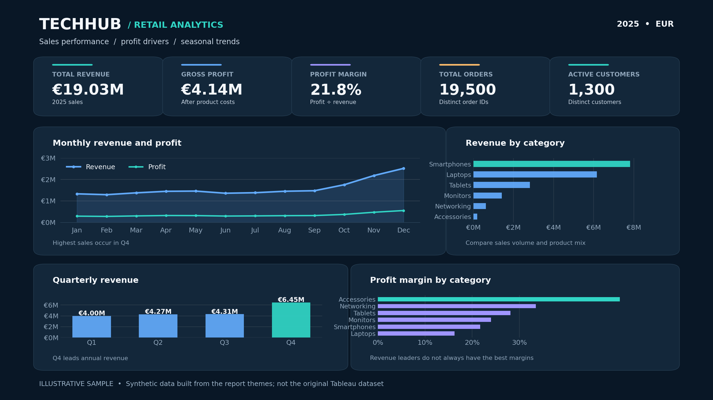
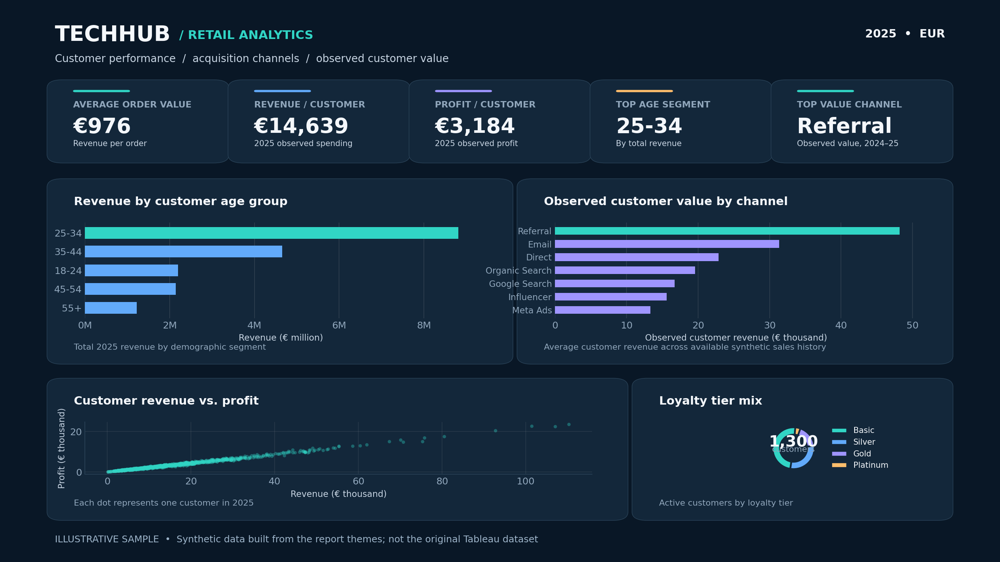

# TechHub Retail | Sales, Profitability & Customer Analytics

**Tableau · Python · Google Colab · Business Intelligence · Retail Analytics**

> **Data provenance:** This repository combines (1) original Tableau figures and qualitative findings from my internship project report with (2) a **separately generated synthetic dataset** for a reproducible Python demonstration. The **original transaction-level internship dataset and Tableau workbook were not supplied**. All euro KPI totals below are **synthetic demonstration results**, not actual company figures.



## Project overview

TechHub Retail is the consumer-electronics business examined in my internship analytics report. I used Tableau to explore sales, customer, product, supplier and marketing-acquisition performance, turning visual evidence into recommendations for profitability and 2025 business planning. The repository also includes a self-contained Python/Google Colab notebook and linked sample CSVs so another analyst can reproduce a comparable workflow.

**Core questions**

- Which product categories generate revenue, and how do profit margins differ?
- How do sales and profit change across months and quarters?
- Which customer age groups and acquisition channels show higher observed value?
- Which suppliers and product age bands deserve closer attention?
- What actions could improve marketing efficiency, retention and inventory planning?

## Dashboards and visual evidence

### 1. Original Tableau figures — internship report

The figure collection above and the individual images in [`assets/tableau_original/`](assets/tableau_original/) were extracted from the original report. They include a product-category revenue/profit comparison, time trends, a product treemap, and a revenue-versus-profit scatter plot. They are original report visuals, **not** outputs created from the synthetic CSVs.

### 2. Sales and profitability dashboard — synthetic demonstration



### 3. Customer and marketing dashboard — synthetic demonstration



These two redesigned KPI dashboards summarize a **simulated 2025 dataset**. They should not be read as screenshots of the original Tableau workbook.

## Example KPI results — synthetic 2025 data only

| Metric | Simulated result | Definition |
|---|---:|---|
| Total revenue | **€19,030,992.81** | Sum of `revenue_eur` for 2025 sales lines |
| Total profit | **€4,139,505.29** | Sum of `profit_eur` for 2025 sales lines |
| Profit margin | **21.75%** | Total profit / total revenue |
| Orders | **19,500** | Distinct 2025 `order_id` |
| Active customers | **1,300** | Distinct 2025 purchasers |
| Average order value (AOV) | **€975.95** | Revenue / distinct orders |
| Observed revenue per active customer | **€14,639.23** | 2025 revenue / active customers |

**CLV/LTV terminology:** The internship report discusses customer lifetime value, but it does not provide enough source data or a clearly specified modeling horizon to verify a full predictive CLV estimate. The notebook's **observed customer value / LTV proxy** measures recorded customer revenue over the available sample period; the 2025 per-active-customer figure in the table is a different, one-year descriptive metric. **Neither is a predictive lifetime value forecast.**

## Key findings from the original internship report

- **Category mix:** Smartphones had the highest reported category revenue and Accessories the lowest. The report cautions against equating revenue leadership with margin leadership.
- **Seasonality:** Q4 was identified as a strong period for sales performance.
- **Customer acquisition:** Observed value varied by acquisition channel, suggesting different marketing efficiencies.
- **Product lifecycle:** The report describes falling product sales beyond approximately 24 months of product age.
- **Profitability:** Suppliers and customer groups showed margin variation; the original scatter plot indicates a broadly positive revenue/profit relationship with substantial dispersion.

These are findings *reported in the uploaded internship document*. Exact category percentages, channel rankings and company-level totals are **not established** by that document.

## Business recommendations

1. Prioritize higher-margin categories and evaluate supplier performance using both profit and sales volume.
2. Test greater marketing focus on customer acquisition sources with stronger observed customer value, while monitoring acquisition costs.
3. Improve repeat purchasing and retention using loyalty incentives and targeted customer engagement.
4. Align promotions and inventory purchasing with strong Q4 demand and product aging.
5. Extend the analysis with validated retention histories, forecasting, and external market benchmarks before making predictive claims.

## Repository structure

```text
techhub-retail-analytics/
├── README.md
├── PROJECT_SUMMARY.md
├── DATA_PROVENANCE.md
├── requirements.txt
├── .gitignore
├── TechHub_Retail_Analysis_Colab.ipynb
├── TechHub_Retail_Synthetic_Datasets.zip
├── techhub_retail_data/
│   ├── sales.csv
│   ├── customers.csv
│   ├── products.csv
│   ├── suppliers.csv
│   ├── acquisition.csv
│   └── README_DATASET.md
├── outputs/
│   └── analysis_exports/                 # Derived from the simulated sample
│       ├── category_performance.csv
│       ├── supplier_performance.csv
│       ├── monthly_performance.csv
│       ├── quarterly_performance.csv
│       ├── age_group_performance.csv
│       ├── channel_performance.csv
│       ├── product_age_performance.csv
│       └── customer_profit.csv
├── assets/
│   ├── tableau_original/
│   │   ├── report_chart_collection.png
│   │   └── figure_1.png ... figure_4.png
│   └── simulated_kpi_dashboards/
│       ├── sales_profit_kpis_2025.png
│       └── customer_marketing_kpis_2025.png
└── reports/
    ├── Original_Internship_Report.pdf
    └── LinkedIn_2_Page_Showcase.pdf
```

## Run the Python analysis

**In Google Colab**

1. Download `TechHub_Retail_Analysis_Colab.ipynb` and `TechHub_Retail_Synthetic_Datasets.zip` from this repository.
2. Open [Google Colab](https://colab.research.google.com/), upload the `.ipynb` notebook, and run the cells in order.
3. When prompted, upload the ZIP of the simulated datasets.
4. Review the analyses (category, supplier, seasonality, demographics, acquisition, product age and customer profitability) and download the exported summary tables.

**On your computer**

```bash
git clone https://github.com/chiakndi/techhub-retail-analytics.git
cd techhub-retail-analytics
python -m pip install -r requirements.txt
jupyter notebook TechHub_Retail_Analysis_Colab.ipynb
```

> The GitHub URL above will work **after** the repository is created under that name. The notebook detects the included `techhub_retail_data/` folder when run from the repository root; on Colab it accepts the ZIP upload instead.

## Methods and calculations

- **Data relationships:** sales → customers by `customer_id`; sales → products by `product_id`; products → suppliers by `supplier_id`; acquisition by `customer_id`.
- **Revenue:** `quantity × unit_price_eur × (1 - discount_pct)` at sales-line level.
- **Profit:** `revenue_eur - cost_eur` at sales-line level.
- **Margin:** `total profit / total revenue × 100`.
- **AOV:** `total revenue / number of distinct orders`.
- **Observed customer value:** recorded sales revenue per customer over the specified observation window (not a modeled lifetime forecast).
- **Data validation:** relationship keys checked for uniqueness and missing references; joins validated to preserve sales-line grain.

The Colab notebook uses **pandas, NumPy, and Matplotlib**. Tableau was used for the original internship figures; a publishable `.twb`/`.twbx` Tableau workbook was not supplied.

## Reports

- [Original internship analysis report](reports/Original_Internship_Report.pdf) — original 4-page source document with the Tableau figures and narrative.
- [Two-page LinkedIn dashboard showcase](reports/LinkedIn_2_Page_Showcase.pdf) — portfolio-ready summary of visual analysis and separately marked simulated KPIs.

## Limitations and responsible presentation

The source PDF contains descriptions, images and qualitative insights, but **not** the underlying row-level original datasets, complete KPI definitions, or the Tableau workbook. The reproducible CSVs are generated examples, not recovered company records. No results from synthetic data should be attributed to actual TechHub Retail operations.

**Portfolio focus:** Tableau dashboard design, data relationships, KPI interpretation, visual storytelling and clear communication of business implications.
